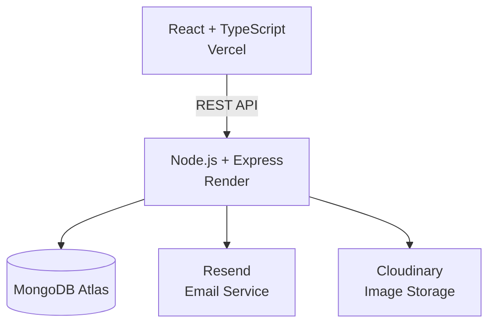

# 🧡 Docvia

**Docvia** is a full-stack doctor appointment booking application built with React, TypeScript, Node.js, and MongoDB.

Patients can discover doctors, explore locations on an interactive map, book appointments, and manage their bookings through a modern dashboard.

🌐 **Live:** https://docvia.space

## Features

- Doctor search with specialty and location filters
- Interactive map powered by MapLibre
- Appointment booking, rescheduling, and cancellation
- Secure authentication and email verification
- Email notifications and appointment reminders
- Patient profiles, favorites, and in-app notifications

## Tech Stack

| Frontend | Backend | Infrastructure |
|---|---|---|
| React 19, TypeScript | Node.js, Express | MongoDB Atlas |
| Vite, Tailwind CSS | Mongoose, JWT | Vercel, Render |
| TanStack Query, Zustand | REST API, Resend | Cloudinary, Docker |

## Architecture

## Quality & CI

- GitHub Actions for frontend and backend checks
- ESLint, Prettier, and TypeScript validation
- Vitest backend unit tests
- Docker support for local deployment
